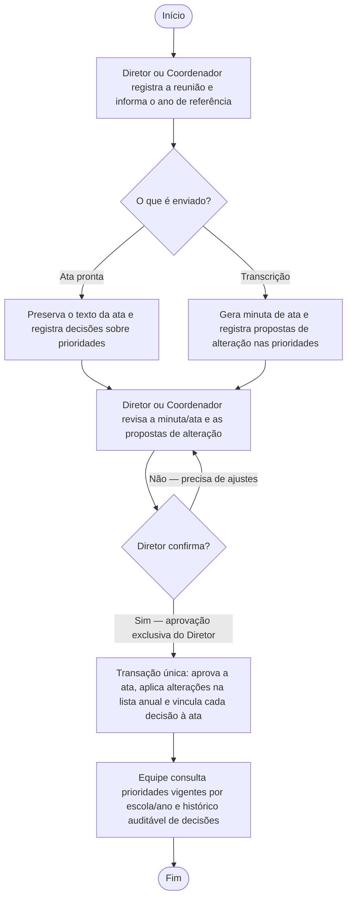
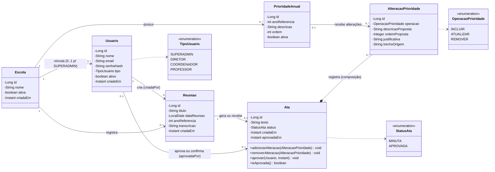
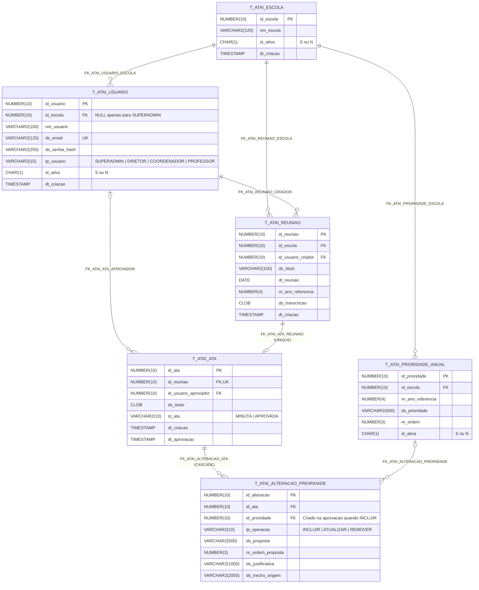

# ATA.I — Backend API

> **Copiloto de gestão escolar para escolas públicas** — Global Solution CitizenTech 2026.2 (FIAP · Engenharia de Software · 2º Ano · *Domain Driven Design — Java*).

[](https://openjdk.org/projects/jdk/21/)
[](https://spring.io/projects/spring-boot)
[](https://www.oracle.com/database/)
[](https://flywaydb.org/)
[](https://www.docker.com/)

---

## Sumário

1. [Visão Geral e Contexto CitizenTech](#1-visão-geral-e-contexto-citizentech)
2. [Ficha da CitizenTech](#2-ficha-da-citizentech)
3. [Diagnóstico do Problema e Evidências](#3-diagnóstico-do-problema-e-evidências)
4. [Visão do Produto e Fluxo Central](#4-visão-do-produto-e-fluxo-central)
5. [Domínio e Diagrama de Classes (DDD — Java)](#5-domínio-e-diagrama-de-classes-ddd--java)
6. [Arquitetura e Stack Tecnológica](#6-arquitetura-e-stack-tecnológica)
7. [Modelo de Dados e Banco Oracle (DER / DDL)](#7-modelo-de-dados-e-banco-oracle-der--ddl)
8. [Catálogo de Endpoints REST](#8-catálogo-de-endpoints-rest)
9. [Atendimento aos Critérios de DDD — Java (GS FIAP)](#9-atendimento-aos-critérios-de-ddd--java-gs-fiap)
10. [Como Executar o Projeto (Docker e Maven)](#10-como-executar-o-projeto-docker-e-maven)
11. [Testes e Qualidade](#11-testes-e-qualidade)
12. [Deploy no Render](#12-deploy-no-render)

---

## 1. Visão Geral e Contexto CitizenTech

**ATA.I** é um copiloto web de gestão escolar voltado a **escolas públicas**, concebido para manter a **lista anual de prioridades**, estruturar o registro de **reuniões e atas**, preservar o **histórico rastreável de decisões administrativas** e apoiar a preparação da **prestação de contas** a partir das atas aprovadas.

Nas escolas públicas, as decisões sobre onde aplicar recursos (como verbas do PDDE) nascem em reuniões colegiadas registradas em ata. Ao longo do ano letivo, novas reuniões revisam, adicionam ou substituem prioridades. Sem uma ligação estruturada entre **atas formais** e a **lista viva de prioridades**, a direção precisa fazer conferências retrospectivas manuais ao final do exercício ou redigir atas complementares para justificar cada alteração.

O **ATA.I** conecta o registro formal das reuniões diretamente à evolução da lista anual de prioridades da escola: cada inclusão, atualização ou remoção mantém vínculo auditável com a **ata de origem**, o **trecho/justificativa** e a **aprovação exclusiva da direção**.

---

## 2. Ficha da CitizenTech

Síntese do projeto conforme o modelo oficial do briefing **Global Solution CitizenTech 2026.2**:

| Campo | Descrição |
|---|---|
| **Nome da CitizenTech** | **ATA.I** — Copiloto de Gestão Escolar |
| **Cidade e território de referência** | Jandira — SP (rede pública de ensino básico) |
| **Cidadão / público beneficiado** | Diretores, coordenadores pedagógicos, professores e comunidade escolar de escolas públicas |
| **Problema, em uma frase** | Dificuldade de acompanhar continuamente as demandas e prioridades anuais da escola e de recuperar, com rastreabilidade, as decisões e justificativas administrativas registradas em atas ao longo do ano. |
| **Como funciona** | Diretor ou coordenador registra uma reunião informando o ano de referência e envia uma ata pronta ou transcrição. As propostas de alteração nas prioridades (`INCLUIR`, `ATUALIZAR`, `REMOVER`) ficam vinculadas à minuta para revisão, e somente o diretor confirma a ata — aplicando as alterações em transação única e preservando o histórico por prioridade. |
| **O que o Backend (DDD — Java) faz** | API RESTful em Java 21 e Spring Boot 3.5 integrada ao Oracle Database (FIAP), estruturada nas camadas `model`, `dao`, `bo`, `controller`, `dto`, `exception` e `config`, com controle transacional de aprovação de atas e rastreabilidade histórica. |
| **Indicador de impacto (candidato)** | Tempo total necessário para registrar, revisar e recuperar uma decisão administrativa e sua justificativa de origem (comparando o fluxo manual fragmentado com o fluxo assistido), além da taxa de retrabalho/correção na revisão. |
| **ODS conectados (Agenda 2030 ONU)** | **ODS 4** (*Educação de Qualidade* — fortalecimento da gestão escolar pública), **ODS 10** (*Redução das Desigualdades* — apoio técnico-administrativo a escolas públicas com sobrecarga operacional) e **ODS 11 / ODS 16** (*Comunidades Sustentáveis e Instituições Eficazes, Responsáveis e Transparentes*). |

---

## 3. Diagnóstico do Problema e Evidências

O recorte de domínio do ATA.I foi construído a partir de investigação de campo e literatura técnica documentadas no workspace do projeto:

1. **Problema central (`P1`):** Dificuldade de acompanhar continuamente demandas, prioridades e decisões administrativas e recuperar suas justificativas ao longo do tempo. **A escola já produz atas formais — o problema não é ausência de documentação**, e sim a desconexão entre atas textuais e o acompanhamento contínuo das prioridades.
2. **Causas e condições observadas (`C1`–`C3`):**
   - `C1`: Atas e controles ficam separados, sem vínculo direto com uma lista anual viva (`E1`: conferência retrospectiva das prioridades no fim do ano).
   - `C2`: Tempo restrito da direção e sobrecarga operacional para alimentar planilhas complexas (`E2`: esforço adicional e risco de retrabalho).
   - `C3`: Mudanças de rota ou aquisições fora da lista original exigem justificativa formal complementar (`E3`: necessidade de atas complementares e busca manual em documentos antigos).
3. **Base de evidências:**
   - **EV1 — Entrevista primária (Jandira/SP, nov/2026):** Diretor de escola pública relatou o ciclo real da ata anual de prioridades, a conferência posterior entre compras realizadas e prioridades aprovadas e a dificuldade de manter controles paralelos complexos na rotina escolar.
   - **EV2 — Revisão sistemática FNDE/UFG sobre o PDDE (101 estudos):** Aponta dificuldades burocráticas (50 estudos), sobrecarga de trabalho (41), assistência técnica insuficiente (32) e lacunas de monitoramento e controle (15).
   - **EV3 — Relatório INEP / Saeb:** Contextualiza a carga administrativa sobre gestores escolares da rede pública.

---

## 4. Visão do Produto e Fluxo Central



### Perfis de Usuário (`TipoUsuario`)

| Perfil | Papel no Domínio |
|---|---|
| `SUPERADMIN` | Administração global de escolas e usuários (único perfil sem vínculo obrigatório a uma escola). |
| `DIRETOR` | Registra reuniões, revisa minutas/propostas e **é o único perfil autorizado a confirmar/aprovar uma ata**. |
| `COORDENADOR` | Registra reuniões, redige/edita minutas e cadastra ou ajusta propostas de alteração enquanto a ata está em `MINUTA`. |
| `PROFESSOR` | Consulta a lista anual de prioridades vigentes e o histórico de decisões aprovadas da sua escola. |

### Escopo do MVP vs. Evoluções Planejadas

- **Implementado neste repositório (Core DDD / MVP):** Gestão de escolas, usuários, reuniões, atas (`MINUTA` → `APROVADA`), propostas de alteração (`INCLUIR`, `ATUALIZAR`, `REMOVER`), confirmação transacional exclusiva pelo diretor, lista vigente de prioridades por escola/ano e consulta ao histórico completo de alterações por prioridade.
- **Evoluções futuras previstas na visão do produto:**
  - *Extração assistida por IA* a partir da transcrição bruta (o backend já possui todos os campos de domínio para receber a minuta, o `trechoOrigem` e a `justificativa`).
  - *Prestação de contas* (vinculação de despesas e comprovantes às prioridades aprovadas para exportação de planilha/documento de apoio).
  - *Autenticação e autorização* via Spring Security.

---

## 5. Domínio e Diagrama de Classes (DDD — Java)

O código Java reflete **fielmente e sem desvios** o Diagrama de Classes UML oficial do projeto:



### Regras de Domínio e Invariantes Garantidas na Camada `bo`

1. **Vínculo escolar por perfil (`UsuarioBO` + `CK_ATAI_USUARIO_ESCOLA`):** Perfis escolares (`DIRETOR`, `COORDENADOR`, `PROFESSOR`) exigem escola ativa vinculada (`id_escola IS NOT NULL`). O perfil `SUPERADMIN` possui atuação global e não pode ser vinculado a uma escola (`id_escola IS NULL`).
2. **Autoria da reunião (`ReuniaoBO`):** Apenas usuários ativos com perfil `DIRETOR` ou `COORDENADOR` pertencentes à mesma escola da reunião podem registrá-la.
3. **Imutabilidade após aprovação (`ReuniaoBO` e `AtaBO`):** Enquanto a ata está em status `MINUTA`, seu texto, suas propostas de alteração e os dados da reunião podem ser editados ou excluídos. Após a ata passar para `APROVADA`, qualquer tentativa de edição ou exclusão da ata, de suas propostas ou da reunião é bloqueada com erro `422 Unprocessable Entity` (`BusinessRuleException`).
4. **Isolamento de propostas (`AtaBO`):**
   - Enquanto `MINUTA`, nenhuma proposta modifica a tabela `T_ATAI_PRIORIDADE_ANUAL`.
   - `INCLUIR`: não aponta para prioridade existente (`prioridadeId == null`) e exige `descricaoProposta`. O vínculo com a nova `PrioridadeAnual` é criado e preenchido no momento da aprovação.
   - `ATUALIZAR`: exige `prioridadeId` de uma prioridade ativa da mesma escola e ano da reunião, além de ao menos um novo valor (`descricaoProposta` ou `ordemProposta`).
   - `REMOVER`: exige `prioridadeId` de uma prioridade ativa da mesma escola e ano da reunião. Na confirmação, realiza desativação lógica (`ativa = false` / `st_ativa = 'N'`), preservando o ID e todo o histórico anterior.
5. **Confirmação transacional exclusiva do Diretor (`AtaBO.confirmar`):**
   - Valida que o aprovador existe, está ativo, possui perfil `DIRETOR` e pertence à mesma escola da reunião.
   - Aplica em uma única transação (`@Transactional`) todas as propostas da ata sobre a lista anual de prioridades e registra `aprovadaPor`, `aprovadaEm` e `status = APROVADA`.

---

## 6. Arquitetura e Stack Tecnológica

A aplicação segue uma arquitetura em **monólito modular em camadas**, alinhada aos padrões exigidos na disciplina de **Domain Driven Design — Java**:

```mermaid
flowchart LR
    Client([Cliente HTTP / Frontend]) -->|JSON DTOs| C[controller]
    C -->|DTOs Validados| B[bo / service]
    B -->|Entidades JPA| D[dao / repository]
    D -->|JPA / Hibernate| M[model / entity]
    M -->|ojdbc11 / Flyway| O[(Oracle Database FIAP)]
    E[exception] -.->|@RestControllerAdvice| C
```

| Camada / Pacote | Responsabilidade |
|---|---|
| `br.com.atai.controller` | Recebe requisições REST (`GET`, `POST`, `PUT`, `DELETE`), valida payloads com `@Valid` e retorna `ResponseEntity` com códigos HTTP semânticos (`200`, `201`, `204`). |
| `br.com.atai.dto` | Contratos imutáveis (`record`) de entrada (`dto.request`) com Jakarta Bean Validation e de saída (`dto.response`). **Entidades JPA nunca são expostas diretamente nos contratos HTTP.** |
| `br.com.atai.bo` | *Business Objects* (`@Service`): concentram casos de uso, validações de regras de negócio e controle transacional (`@Transactional`). |
| `br.com.atai.dao` | *Data Access Objects*: interfaces Spring Data JPA com consultas JPQL otimizadas (`JOIN FETCH` para evitar *N+1* e `LazyInitializationException` com `open-in-view: false`). |
| `br.com.atai.model` | Entidades JPA mapeadas para o Oracle Database, enums de domínio e conversor `BooleanSimNaoConverter` (`boolean` ↔ `CHAR(1)` `'S'`/`'N'`). |
| `br.com.atai.exception` | Tratamento centralizado de erros (`GlobalExceptionHandler`) com resposta padronizada (`ErrorResponse`) para erros de domínio (`404`, `409`, `422`), validação (`400`) e infraestrutura (`405`, `415`, `500`). |
| `br.com.atai.config` | Configuração do OpenAPI/Swagger (`OpenApiConfig`) e validação fail-fast das variáveis de ambiente do Oracle na inicialização (`RequiredDatabaseVariablesValidator`). |

### Tecnologias e Versões

| Componente | Escolha / Versão |
|---|---|
| **Linguagem** | Java 21 (LTS) |
| **Framework Base** | Spring Boot 3.5.16 (`spring-boot-starter-web`, `data-jpa`, `validation`, `actuator`) |
| **Persistência e Driver** | Hibernate / Spring Data JPA + Oracle JDBC Driver (`ojdbc11`) + HikariCP |
| **Migração de Esquema** | Flyway (`flyway-core` + `flyway-database-oracle`) com `ddl-auto: validate` |
| **Documentação da API** | Springdoc OpenAPI 2.8.17 (Swagger UI + OpenAPI 3) |
| **Testes** | JUnit 5, Mockito, AssertJ e Spring `MockMvc` (41 testes automatizados) |
| **Build e Container** | Maven Wrapper 3.3.4 (Maven 3.10.1) + Docker Multi-stage (`eclipse-temurin:21`) |

### Estrutura do Repositório

```text
ata.i-backend/
├── .github/workflows/ci.yml              # Pipeline CI: compilação e testes automatizados
├── .mvn/wrapper/                         # Maven Wrapper (dispensa instalação prévia do Maven)
├── src/
│   ├── main/
│   │   ├── java/br/com/atai/
│   │   │   ├── AtaiApplication.java
│   │   │   ├── bo/                       # EscolaBO, UsuarioBO, ReuniaoBO, AtaBO, PrioridadeAnualBO
│   │   │   ├── config/                   # OpenApiConfig, RequiredDatabaseVariablesValidator
│   │   │   ├── controller/               # 5 Controllers REST (Escolas, Usuarios, Prioridades, Reunioes, Atas)
│   │   │   ├── dao/                      # 6 Repositories Spring Data JPA
│   │   │   ├── dto/
│   │   │   │   ├── request/              # 10 DTOs de entrada com Bean Validation
│   │   │   │   └── response/             # 7 DTOs de saída
│   │   │   ├── exception/                # GlobalExceptionHandler, ErrorResponse, 404/409/422 exceptions
│   │   │   └── model/                    # 6 Entidades JPA, converter S/N e 3 Enums
│   │   └── resources/
│   │       ├── application.yml           # Configuração base (Oracle, Hikari, JPA validate, Flyway)
│   │       ├── application-local.yml     # Perfil local
│   │       ├── application-prod.yml      # Perfil de produção (Render / Docker)
│   │       └── db/migration/
│   │           └── V1__create_tables.sql # Migration Flyway para criação do esquema no Oracle
│   └── test/java/br/com/atai/            # 41 testes unitários e slice WebMvc (BOs, Controllers, Exceptions, Config)
├── ATAI_01_DDL.sql                       # Script DDL completo (Oracle 19c+) alinhado à disciplina de Database Design
├── compose.yaml                          # Docker Compose para execução local containerizada
├── Dockerfile                            # Build multi-stage com execução em usuário não-root
├── .env.example                          # Modelo de variáveis de ambiente
├── mvnw / mvnw.cmd                       # Executáveis do Maven Wrapper
└── pom.xml
```

---

## 7. Modelo de Dados e Banco Oracle (DER / DDL)

O esquema relacional foi projetado especificamente para o **Oracle Database 19c+** da FIAP (veja o script completo em [`ATAI_01_DDL.sql`](./ATAI_01_DDL.sql) e a migration [`V1__create_tables.sql`](./src/main/resources/db/migration/V1__create_tables.sql)):



### Decisões de Mapeamento Relacional (Oracle + Hibernate)

- **Chaves Primárias:** `NUMBER(10) GENERATED BY DEFAULT AS IDENTITY` mapeadas com `@GeneratedValue(strategy = GenerationType.IDENTITY)`.
- **Booleanos em Oracle:** Mapeados para `CHAR(1)` (`'S'`/`'N'`) com constraint `CHECK` no banco e `@Convert(converter = BooleanSimNaoConverter.class)` no JPA.
- **Textos longos:** `ds_transcricao` e `ds_texto` utilizam `CLOB` (`@Lob`), com carregamento `LAZY` na transcrição da reunião.
- **Datas e Instantes:** `LocalDate` → `DATE`; `Instant` → `TIMESTAMP` sempre normalizado em `UTC` (`hibernate.jdbc.time_zone: UTC`).
- **Governança de Esquema:** `spring.jpa.hibernate.ddl-auto: validate`. O Hibernate **nunca** altera tabelas autonomamente; o Flyway aplica a migration `V1__create_tables.sql` e o Hibernate valida a conformidade de todas as entidades na subida.

---

## 8. Catálogo de Endpoints REST

Todos os 5 controladores expõem operações **`GET`, `POST`, `PUT` e `DELETE`** com códigos HTTP semânticos e respostas de erro padronizadas:

| Recurso | Método | Rota | Status Sucesso | Descrição |
|---|---|---|---|---|
| **Escolas** | `GET` | `/api/escolas?incluirInativas=false` | `200 OK` | Lista escolas (ativas por padrão ou todas). |
| **Escolas** | `GET` | `/api/escolas/{id}` | `200 OK` | Busca uma escola por ID. |
| **Escolas** | `POST` | `/api/escolas` | `201 Created` | Cadastra nova escola pública. |
| **Escolas** | `PUT` | `/api/escolas/{id}` | `200 OK` | Atualiza nome e status de ativação da escola. |
| **Escolas** | `DELETE` | `/api/escolas/{id}` | `204 No Content` | Desativa logicamente a escola (`st_ativa = 'N'`). |
| **Usuários** | `GET` | `/api/usuarios?escolaId={id}` | `200 OK` | Lista usuários (opcionalmente filtrados por escola). |
| **Usuários** | `GET` | `/api/usuarios/{id}` | `200 OK` | Busca um usuário por ID. |
| **Usuários** | `POST` | `/api/usuarios` | `201 Created` | Cria usuário validando regra `SUPERADMIN` vs. perfil escolar. |
| **Usuários** | `PUT` | `/api/usuarios/{id}` | `200 OK` | Atualiza dados, perfil, escola ou status do usuário. |
| **Usuários** | `DELETE` | `/api/usuarios/{id}` | `204 No Content` | Desativa logicamente o usuário (`st_ativo = 'N'`). |
| **Prioridades Anuais** | `GET` | `/api/prioridades?escolaId={id}&ano={ano}` | `200 OK` | Lista prioridades vigentes ordenadas por `nr_ordem`. |
| **Prioridades Anuais** | `GET` | `/api/prioridades/{id}` | `200 OK` | Detalha uma prioridade anual por ID. |
| **Prioridades Anuais** | `POST` | `/api/prioridades` | `201 Created` | Cria prioridade anual manualmente. |
| **Prioridades Anuais** | `PUT` | `/api/prioridades/{id}` | `200 OK` | Atualiza descrição, ordem ou status de uma prioridade. |
| **Prioridades Anuais** | `DELETE` | `/api/prioridades/{id}` | `204 No Content` | Desativa logicamente a prioridade (`st_ativa = 'N'`). |
| **Prioridades Anuais** | `GET` | `/api/prioridades/{id}/historico` | `200 OK` | Lista o histórico auditável de alterações aprovadas e suas atas de origem. |
| **Reuniões** | `GET` | `/api/reunioes?escolaId={id}&ano={ano}` | `200 OK` | Lista reuniões filtráveis por escola e ano de referência. |
| **Reuniões** | `GET` | `/api/reunioes/{id}` | `200 OK` | Detalha reunião (incluindo transcrição e criador). |
| **Reuniões** | `POST` | `/api/reunioes` | `201 Created` | Registra nova reunião (criador deve ser `DIRETOR` ou `COORDENADOR` da escola). |
| **Reuniões** | `PUT` | `/api/reunioes/{id}` | `200 OK` | Atualiza reunião (bloqueado se a ata vinculada já estiver `APROVADA`). |
| **Reuniões** | `DELETE` | `/api/reunioes/{id}` | `204 No Content` | Exclui reunião (bloqueado se a ata vinculada já estiver `APROVADA`). |
| **Reuniões / Ata** | `GET` | `/api/reunioes/{id}/ata` | `200 OK` | Obtém a ata vinculada à reunião. |
| **Reuniões / Ata** | `POST` | `/api/reunioes/{id}/ata` | `201 Created` | Cria a ata da reunião com status inicial `MINUTA`. |
| **Atas** | `GET` | `/api/atas/{id}` | `200 OK` | Detalha a ata e todas as suas propostas de alteração. |
| **Atas** | `PUT` | `/api/atas/{id}` | `200 OK` | Edita o texto da ata (somente enquanto `MINUTA`). |
| **Atas** | `DELETE` | `/api/atas/{id}` | `204 No Content` | Exclui a ata e suas propostas (somente enquanto `MINUTA`). |
| **Alterações da Ata** | `GET` | `/api/atas/{id}/alteracoes` | `200 OK` | Lista as propostas de alteração registradas na ata. |
| **Alterações da Ata** | `POST` | `/api/atas/{id}/alteracoes` | `201 Created` | Adiciona proposta (`INCLUIR`, `ATUALIZAR` ou `REMOVER`) à ata em `MINUTA`. |
| **Alterações da Ata** | `PUT` | `/api/atas/{id}/alteracoes/{alteracaoId}` | `200 OK` | Edita proposta de alteração (somente enquanto `MINUTA`). |
| **Alterações da Ata** | `DELETE` | `/api/atas/{id}/alteracoes/{alteracaoId}` | `204 No Content` | Remove proposta de alteração (somente enquanto `MINUTA`). |
| **Confirmação da Ata** | `POST` | `/api/atas/{id}/confirmacao` | `200 OK` | **Exclusivo do Diretor:** aprova a ata e aplica todas as alterações em transação única. |

### Padrão de Resposta de Erro (`ErrorResponse`)

Qualquer erro retorna um JSON estruturado sem expor *stack traces*:

```json
{
  "timestamp": "2026-11-18T22:00:00Z",
  "status": 422,
  "error": "Unprocessable Entity",
  "message": "Somente um usuário com perfil DIRETOR pode confirmar a ata.",
  "path": "/api/atas/10/confirmacao",
  "violations": []
}
```

| Código HTTP | Exceção / Situação |
|---|---|
| `400 Bad Request` | Falha no Jakarta Bean Validation (`MethodArgumentNotValidException`), JSON malformado ou parâmetro inválido. |
| `404 Not Found` | `ResourceNotFoundException` (escola, usuário, reunião, ata, prioridade ou alteração inexistente). |
| `405 Method Not Allowed` | Método HTTP não suportado pela rota. |
| `409 Conflict` | `ConflictException` (e-mail já cadastrado ou reunião que já possui ata). |
| `415 Unsupported Media Type` | `Content-Type` diferente de `application/json`. |
| `422 Unprocessable Entity` | `BusinessRuleException` (violação de regra de domínio: ata já aprovada, perfil sem permissão para aprovar/criar, escola incompatível). |
| `500 Internal Server Error` | Falha interna inesperada (registrada em log no servidor com mensagem genérica ao cliente). |

---

## 9. Atendimento aos Critérios de DDD — Java (GS FIAP)

Mapeamento direto dos entregáveis exigidos nas páginas 32 e 33 do documento oficial da **Global Solution 2026.2 — Domain Driven Design (Java)**:

### Parte Técnica (70 Pontos)

| Critério Avaliativo (PDF GS) | Pontuação | Situação | Como o projeto atende |
|---|---|---|---|
| **Camada Modelo (`model`)** compatível com o banco Oracle da FIAP | 10 pts | ✅ Concluído | 6 entidades JPA (`Escola`, `Usuario`, `Reuniao`, `Ata`, `PrioridadeAnual`, `AlteracaoPrioridade`), 3 enums e conversor `BooleanSimNaoConverter` mapeados para `T_ATAI_*` e validados com `ddl-auto: validate`. |
| **Camadas DAO e BO (`dao` e `bo`)** | 10 pts | ✅ Concluído | 6 repositórios Spring Data JPA (`dao`) e 5 classes de negócio (`bo`) com todas as regras de domínio e transações `@Transactional`. |
| **Camada Controller (`controller`)** com `GET`, `POST`, `PUT` e `DELETE` | 10 pts | ✅ Concluído | 5 controllers REST cobrindo todos os verbos HTTP (`GET`, `POST`, `PUT`, `DELETE`) em todos os recursos do domínio, utilizando DTOs de entrada e saída. |
| **Camada de Tratamento de Exceções (`exception`)** | 10 pts | ✅ Concluído | `GlobalExceptionHandler` (`@RestControllerAdvice`), `ErrorResponse` e exceções semânticas (`ResourceNotFoundException`, `ConflictException`, `BusinessRuleException`). |
| **Deploy em servidor de aplicação (`render.com`)** | 30 pts | 📦 Pronto para deploy | `Dockerfile` multi-stage otimizado, suporte dinâmico à variável `PORT`, profile `prod` e health check `/actuator/health` prontos. Veja a seção [Deploy no Render](#12-deploy-no-render). |

### Documentação — PDF Único de Entrega (30 Pontos)

Observações importantes para garantir a pontuação máxima na montagem do PDF único da disciplina:

1. **Especificação do projeto (5 pts):** Incluir capa (nome do projeto **ATA.I**, nomes completos e RMs dos integrantes), página de sumário/índice e as seções 1 a 4 deste README (descrição da solução, justificativa com base nas evidências e objetivos).
2. **Diagrama de Classes (10 pts):** Utilizar o diagrama de classes UML oficial do projeto (seção 5), que reflete 100% os atributos, tipos, métodos e relacionamentos implementados em `src/main/java/br/com/atai/model`.
3. **Protótipos de tela, requisições e DER (10 pts):**
   - Exportar as telas do protótipo no Figma ([ATA.I — Telas e fluxos no Figma](https://www.figma.com/design/w2chJ7lwdxCcgJGQqrQjgc/Prototipos?node-id=5-230)).
   - Incluir a tabela completa de endpoints `GET`, `POST`, `PUT` e `DELETE` (seção 8).
   - Incluir o Diagrama Entidade-Relacionamento (DER) gerado no Oracle Data Modeler correspondente ao script [`ATAI_01_DDL.sql`](./ATAI_01_DDL.sql).
4. **Lista de instruções claras para executar o projeto (5 pts):** Incluir ferramentas (IntelliJ IDEA / Docker / Maven), versões (JDK 21, Spring Boot 3.5.16, Oracle 19c+), link do repositório GitHub, link do deploy no Render e o passo a passo da seção 10 abaixo.
   > **Atenção ao prazo do PDF:** *Commits realizados no GitHub após a data/horário limite da entrega (19/11 às 23h55) zeram a nota da parte técnica.*

---

## 10. Como Executar o Projeto (Docker e Maven)

### 10.1. Pré-requisitos

- **Credenciais do Oracle Database da FIAP** (`DB_URL`, `DB_USERNAME`, `DB_PASSWORD`).
- **Para rodar com Docker (recomendado):** [Docker](https://docs.docker.com/get-docker/) e Docker Compose instalados (não exige instalar Java ou Maven na máquina).
- **Para rodar localmente sem Docker:** **JDK 21** instalado (`java -version`). O projeto inclui o *Maven Wrapper* (`./mvnw` / `.\mvnw.cmd`).

---

### 10.2. Configurar as Variáveis de Ambiente (`.env`)

Na raiz do projeto, crie o arquivo `.env` a partir do modelo `.env.example`:

```bash
# Linux / macOS
cp .env.example .env

# Windows (PowerShell ou CMD)
copy .env.example .env
```

Edite o arquivo `.env` e preencha as credenciais do Oracle da FIAP:

```properties
SPRING_PROFILES_ACTIVE=local
PORT=8080

# Exemplo FIAP: jdbc:oracle:thin:@//oracle.fiap.com.br:1521/ORCL
DB_URL=jdbc:oracle:thin:@//oracle.fiap.com.br:1521/ORCL
DB_USERNAME=RMXXXXXX
DB_PASSWORD=SUA_SENHA_AQUI
DB_POOL_MAX_SIZE=5
SWAGGER_ENABLED=true
```

> [!WARNING]
> - **Não utilize aspas** ao redor dos valores no `.env` (ele é lido no formato *properties*).
> - Caso sua senha possua barra invertida (`\`), escape-a como `\\` quando executar via Maven local.
> - A aplicação valida a presença de `DB_URL`, `DB_USERNAME` e `DB_PASSWORD` antes de abrir conexões (`RequiredDatabaseVariablesValidator`) e **não usa banco em memória (H2)** como fallback.
> - Na primeira inicialização com um schema limpo, o **Flyway** executará automaticamente a migration `V1__create_tables.sql` para criar as 6 tabelas `T_ATAI_*`, constraints e índices.

---

### 10.3. Passo a Passo com Docker (Recomendado)

O projeto possui um [`Dockerfile`](./Dockerfile) *multi-stage* (compila com `eclipse-temurin:21-jdk`, gera o pacote enxuto e executa em `eclipse-temurin:21-jre-alpine` com usuário não-root `atai`) e um arquivo [`compose.yaml`](./compose.yaml) pronto.

#### Opção A — Usando Docker Compose (1 comando)

1. Certifique-se de que o arquivo `.env` está preenchido na raiz do repositório.
2. Suba o serviço construindo a imagem:
   ```bash
   docker compose up --build
   ```
   *(Para rodar em segundo plano, adicione `-d`: `docker compose up --build -d`)*
3. Acompanhe os logs para confirmar que o Flyway validou o schema e o pool `atai-hikari` conectou ao Oracle:
   ```bash
   docker compose logs -f
   ```
4. Teste se o container está saudável:
   ```bash
   curl http://localhost:8080/actuator/health
   # Resposta esperada: {"status":"UP"}
   ```
5. Para encerrar o container:
   ```bash
   docker compose down
   ```

#### Opção B — Usando `docker build` e `docker run` diretamente

1. Construa a imagem Docker:
   ```bash
   docker build -t atai-backend:latest .
   ```
2. Execute o container injetando o arquivo `.env`:
   ```bash
   docker run --rm --name atai-backend -p 8080:8080 --env-file .env atai-backend:latest
   ```
   *(Ou passando as variáveis explicitamente com `-e DB_URL=... -e DB_USERNAME=... -e DB_PASSWORD=...`)*

---

### 10.4. Passo a Passo com Maven Wrapper (Execução Local / IDE)

Com o `.env` configurado na raiz do projeto e o JDK 21 ativo:

```bash
# Linux / macOS
./mvnw spring-boot:run

# Windows (PowerShell / CMD)
.\mvnw.cmd spring-boot:run
```

---

### 10.5. Acessando a Documentação Interativa (Swagger / OpenAPI)

Com a aplicação rodando (via Docker ou Maven), acesse no navegador:

- **Swagger UI:** http://localhost:8080/swagger-ui.html
- **Especificação OpenAPI (JSON):** http://localhost:8080/v3/api-docs
- **Health Check (Actuator):** http://localhost:8080/actuator/health

---

## 11. Testes e Qualidade

A suíte automatizada conta com **41 testes** (testes unitários de regras de negócio para todos os BOs com JUnit 5 + Mockito, testes de slice HTTP `@WebMvcTest` para todos os Controllers e `GlobalExceptionHandler`, e testes de validação de configuração), que rodam **sem depender de conexão ativa com o Oracle**:

```bash
# Linux / macOS
./mvnw clean verify

# Windows (PowerShell / CMD)
.\mvnw.cmd clean verify
```

| Classe de Teste | Escopo Validado |
|---|---|
| `AtaBOTest` | Criação de ata, bloqueio pós-aprovação, adição/edição/remoção de propostas (`INCLUIR`, `ATUALIZAR`, `REMOVER`) e confirmação transacional exclusiva por `DIRETOR` da escola. |
| `ReuniaoBOTest` | Criação por `DIRETOR`/`COORDENADOR`, rejeição de `PROFESSOR` ou escola diferente, bloqueio de edição/exclusão após aprovação da ata. |
| `PrioridadeAnualBOTest` | CRUD de prioridades, cálculo automático de ordem e consulta de histórico rastreável até a ata. |
| `UsuarioBOTest` | Regras de vínculo obrigatório de escola para perfis escolares e proibição de escola para `SUPERADMIN`, unicidade de e-mail. |
| `EscolaBOTest` | Criação, listagem (ativas/inativas), atualização e desativação lógica. |
| `ApiControllersWebMvcTest` | Contratos HTTP (`200`, `201`, `204`, `400`, `404`, `409`, `422`) de todos os 5 controllers via `MockMvc`. |
| `GlobalExceptionHandlerTest` / `WebMvcTest` | Formatação de `ErrorResponse` para todas as exceções de domínio e de infraestrutura. |
| `RequiredDatabaseVariablesValidatorTest` | Interrupção fail-fast quando `DB_URL`, `DB_USERNAME` ou `DB_PASSWORD` não são informadas. |

---

## 12. Deploy no Render

A aplicação está pronta para deploy como **Web Service (Docker)** no [Render](https://render.com):

1. No painel do Render, clique em **New → Web Service** e conecte este repositório GitHub.
2. Selecione **Runtime:** `Docker` (o Render utilizará o `Dockerfile` da raiz).
3. Configure as **Environment Variables** no painel do Render:
   - `SPRING_PROFILES_ACTIVE` = `prod`
   - `DB_URL` = `jdbc:oracle:thin:@//<HOST_ORACLE_FIAP>:<PORTA>/<SERVICE_NAME>`
   - `DB_USERNAME` = `<SEU_USUARIO_ORACLE_FIAP>`
   - `DB_PASSWORD` = `<SUA_SENHA_ORACLE_FIAP>`
   - `SWAGGER_ENABLED` = `true` (permite ao professor visualizar e testar o Swagger UI diretamente pelo link do deploy)
   - *(A variável `PORT` é injetada automaticamente pelo Render e respeitada por `server.port: ${PORT:8080}`)*
4. Defina o **Health Check Path** como `/actuator/health`.
5. Clique em **Create Web Service** e acompanhe o log até a mensagem `Started AtaiApplication`.
