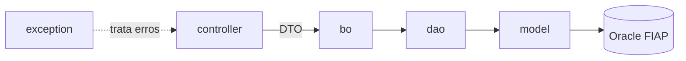

# ATA.I — Backend

Copiloto de gestão escolar para escolas públicas — Global Solution CitizenTech 2026.2 (FIAP, Domain Driven Design — Java).

O ATA.I organiza **prioridades anuais**, registra **reuniões** e **atas**, preserva o histórico das decisões e permite rastrear alterações nas prioridades até suas atas de origem.

## Objetivo do backend

Fornecer uma API RESTful em Java/Spring Boot, persistida no Oracle Database da FIAP, organizada em camadas (Model, DAO, BO, Controller e Exception) e implantável no Render via Docker.

> **Estado atual: scaffold de infraestrutura.** Nenhuma funcionalidade de negócio está implementada. Veja [Estado atual](#estado-atual-da-implementação).

## Stack e versões

| Item | Versão |
|---|---|
| Java | 21 (bytecode alvo; compila também com JDK mais novo) |
| Spring Boot | 3.5.16 |
| Maven | 3.10.1 via Maven Wrapper 3.3.4 (não é preciso instalar Maven) |
| Spring Web / Spring Data JPA / Hibernate | gerenciados pelo Spring Boot |
| Pool de conexões | HikariCP (padrão do Spring Boot) |
| Oracle JDBC | `ojdbc11` (gerenciado pelo Spring Boot) |
| Jakarta Bean Validation | `spring-boot-starter-validation` |
| Springdoc OpenAPI | 2.8.17 |
| Flyway | `flyway-core` + `flyway-database-oracle` — **desabilitado** |
| Actuator | apenas `health` e `info` expostos |
| Testes | JUnit 5 + Mockito + AssertJ (`spring-boot-starter-test`) |
| Container | Docker (`eclipse-temurin:21-jdk` → `eclipse-temurin:21-jre-alpine`) |

**Justificativas das dependências fora da lista base**
- **Actuator:** fornece `/actuator/health` para verificar o serviço no Render e no Docker. Só `health` e `info` são expostos, sem detalhes.
- **Flyway (desabilitado):** já está pronto para versionar o esquema. Fica desligado (`spring.flyway.enabled=false`) até confirmar a versão do Oracle da FIAP e as permissões do usuário (`CREATE TABLE` e criação da tabela `flyway_schema_history`).

## Arquitetura

Monólito modular em camadas:



| Pacote | Responsabilidade |
|---|---|
| `controller` | Endpoints HTTP; usa DTOs e delega aos BOs |
| `dto` | Contratos de entrada e saída (records + Bean Validation) |
| `bo` | Casos de uso, regras de negócio e transações |
| `dao` | Persistência (repositórios Spring Data JPA) |
| `model` | Entidades JPA mapeadas para o Oracle |
| `exception` | `@RestControllerAdvice` e corpo padronizado de erro |
| `config` | Configurações técnicas (OpenAPI, validação das variáveis do Oracle) |

Entidades JPA nunca são expostas diretamente nos contratos HTTP.

## Estrutura de pastas

```text
ata.i-backend/
├── .github/workflows/ci.yml          # CI: build + testes sem Oracle
├── .mvn/wrapper/                     # Maven Wrapper
├── src/
│   ├── main/
│   │   ├── java/br/com/atai/
│   │   │   ├── AtaiApplication.java
│   │   │   ├── config/
│   │   │   │   ├── OpenApiConfig.java
│   │   │   │   └── RequiredDatabaseVariablesValidator.java
│   │   │   ├── controller/           # (vazio — package-info.java)
│   │   │   ├── dto/                  # (vazio — package-info.java)
│   │   │   ├── model/                # (vazio — package-info.java)
│   │   │   ├── dao/                  # (vazio — package-info.java)
│   │   │   ├── bo/                   # (vazio — package-info.java)
│   │   │   └── exception/
│   │   │       ├── ErrorResponse.java
│   │   │       └── GlobalExceptionHandler.java
│   │   └── resources/
│   │       ├── application.yml
│   │       ├── application-local.yml
│   │       ├── application-prod.yml
│   │       └── db/migration/         # vazio (Flyway desabilitado)
│   └── test/java/br/com/atai/
│       ├── config/
│       │   ├── OpenApiConfigTest.java
│       │   └── RequiredDatabaseVariablesValidatorTest.java
│       └── exception/
│           ├── GlobalExceptionHandlerTest.java        # unitário + Mockito
│           └── GlobalExceptionHandlerWebMvcTest.java  # slice web, sem JPA
├── .dockerignore
├── .env.example
├── .gitignore
├── AGENTS.md
├── compose.yaml
├── Dockerfile
├── mvnw / mvnw.cmd
├── pom.xml
└── README.md
```

## Pré-requisitos

- **JDK 21 ou superior** (`java -version`).
- Acesso ao **Oracle Database da FIAP**: URL, usuário e senha.
- Opcional: **Docker** e Docker Compose.
- Maven **não** precisa ser instalado; use `./mvnw` (Linux/macOS) ou `.\mvnw.cmd` (Windows).

## Variáveis de ambiente

```bash
cp .env.example .env      # Windows: copy .env.example .env
```

| Variável | Obrigatória | Descrição |
|---|---|---|
| `SPRING_PROFILES_ACTIVE` | não (padrão `local`) | `local` ou `prod` |
| `DB_URL` | **sim** | `jdbc:oracle:thin:@//HOST:PORT/SERVICE_NAME` |
| `DB_USERNAME` | **sim** | Usuário Oracle |
| `DB_PASSWORD` | **sim** | Senha Oracle |
| `PORT` | não (padrão `8080`) | Porta HTTP |
| `DB_POOL_MAX_SIZE` | não (padrão `5`) | Tamanho máximo do pool Hikari |
| `SWAGGER_ENABLED` | não (padrão `true`) | Liga/desliga o Swagger no perfil `prod` |

Como o `.env` é lido:
- **Maven/IDE:** o `application.yml` importa `./.env` com `spring.config.import: optional:file:.env[.properties]`. Por isso, rode os comandos **a partir da raiz do projeto**. Variáveis de ambiente reais têm precedência sobre o arquivo.
- **Docker Compose:** o `env_file: .env` injeta as variáveis no container.
- **Render:** as variáveis vêm do painel; não existe `.env`.

> [!WARNING]
> O `.env` é lido como arquivo *properties*. Não use aspas em volta dos valores. Uma `\` na senha precisa ser escrita como `\\`. O `.env` está no `.gitignore` e **nunca deve ser versionado**.

### Banco de dados

- **A aplicação exige uma conexão Oracle válida para iniciar.** Não existe banco embarcado (H2) nem fallback.
- Se `DB_URL`, `DB_USERNAME` ou `DB_PASSWORD` estiverem ausentes ou vazias, a inicialização é interrompida antes de qualquer conexão (`RequiredDatabaseVariablesValidator`) com a mensagem:
  `Configuração do Oracle ausente: defina DB_URL, ... como variáveis de ambiente ou no arquivo .env`.
- `ddl-auto: none`: o Hibernate **não cria nem altera tabelas**. Quando as entidades e tabelas existirem, o valor passará a `validate`.

## Como executar

### Com Maven

```bash
./mvnw spring-boot:run          # Windows: .\mvnw.cmd spring-boot:run
```

### Com Docker

```bash
docker build -t atai-backend .
docker run --rm -p 8080:8080 --env-file .env atai-backend
```

A imagem define `SPRING_PROFILES_ACTIVE=prod` por padrão. O valor do `.env` (ou de `-e`) tem precedência.

### Com Docker Compose

```bash
docker compose up --build
```

O Compose sobe apenas o backend. Não há container Oracle, porque o banco usado é o da FIAP.

## Compilar e testar

```bash
./mvnw clean verify                         # compila e roda os testes sem Oracle
./mvnw verify -Pintegration-tests           # futuros testes *IT (exigem Oracle real)
```

| Tipo | Convenção | Precisa de Oracle | Roda na CI |
|---|---|---|---|
| Unitário / slice | `*Test.java`, `*Tests.java` | Não | Sim |
| Integração | `*IT.java` (perfil `integration-tests`) | **Sim** | Não |

Ainda não existe nenhum teste `*IT`. Não há teste que suba o contexto completo, porque ele exige um Oracle real.

## Swagger / OpenAPI

Com a aplicação em execução:

- Swagger UI: http://localhost:8080/swagger-ui.html
- OpenAPI JSON: http://localhost:8080/v3/api-docs
- Health: http://localhost:8080/actuator/health

O título é "ATA.I API" e a versão, 0.1.0. A documentação ainda não lista endpoints, porque nenhum endpoint de negócio foi implementado.

## Deploy no Render

O deploy **não é automático**. Para configurar:

1. No Render, escolha **New → Web Service** e conecte o repositório GitHub.
2. **Runtime/Language:** `Docker`. O Render detecta o `Dockerfile` na raiz.
3. **Environment Variables:**
   - `SPRING_PROFILES_ACTIVE=prod`
   - `DB_URL`, `DB_USERNAME` e `DB_PASSWORD`, com os dados do Oracle da FIAP.
   - `PORT` é injetada pelo próprio Render. A aplicação já escuta em `0.0.0.0:${PORT}`.
4. **Health Check Path:** `/actuator/health`.
5. Clique em **Create Web Service** e acompanhe os logs. Se faltar configuração ou houver erro de conexão, o motivo aparece na inicialização.

### Conectividade Oracle FIAP ⇄ Render

> [!IMPORTANT]
> Não há garantia de que o Oracle da FIAP aceite conexões vindas do Render, pois pode haver firewall ou restrição de IP/VPN. Valide antes de considerar o deploy funcional.

Como validar:
1. Faça o deploy com as variáveis configuradas e verifique nos logs se o `atai-hikari` iniciou (`HikariPool-1 - Start completed`).
2. Mensagens como `IO Error: The Network Adapter could not establish the connection` ou timeout indicam bloqueio de rede.
3. Pelo **Shell** do serviço no Render, se disponível no plano: `nc -zv HOST PORT`.
4. Se houver bloqueio, informe-o ao professor/FIAP. Não contorne a restrição.

## Dependências externas e limitações

- **Oracle FIAP:** obrigatório para iniciar a aplicação. Host, porta e service name não estão definidos no projeto.
- **Rede Render → FIAP:** a conectividade não foi verificada.
- **Flyway:** desabilitado até validar a compatibilidade e as permissões.
- **Docker:** a imagem precisa de rede para baixar as dependências Maven durante o build.
- **Sem autenticação:** Spring Security será planejado em etapa posterior.

## Estado atual da implementação

| Item | Situação |
|---|---|
| Estrutura Maven, Java 21, Spring Boot 3.5 | ✅ Implementado |
| Configuração Oracle/Hibernate/Hikari por variáveis | ✅ Implementado (conexão real **não validada**) |
| Profiles `local` e `prod` | ✅ Implementado |
| OpenAPI (metadados) | ✅ Implementado |
| Tratamento global de erros de infraestrutura | ✅ Implementado |
| Testes unitários/slice sem Oracle | ✅ Implementado |
| Dockerfile / Compose | ✅ Criados |
| CI (GitHub Actions) | ✅ Criada (execução no GitHub ainda não observada) |
| Entidades, DAOs, BOs, Controllers de negócio | ❌ Não iniciado |
| Exceções de domínio | ❌ Não iniciado |
| Migrations de domínio | ❌ Não iniciado |
| Autenticação/autorização | ❌ Não iniciado |
| Integração com IA | ❌ Não iniciado |
| Deploy no Render | ❌ Não realizado |

## Critérios da FIAP

| Critério | Como a estrutura atende ou prepara |
|---|---|
| **Model compatível com Oracle** | Pacote `model` reservado. JPA/Hibernate com driver `ojdbc11` e `ddl-auto` em `none`, que passará a `validate` contra o esquema Oracle. *Entidades ainda não criadas.* |
| **DAO** | Pacote `dao` reservado para os repositórios Spring Data JPA. *Ainda não criados.* |
| **BO** | Pacote `bo` reservado para regras de negócio e `@Transactional`. *Ainda não criados.* |
| **Controller (GET, POST, PUT, DELETE)** | Spring Web e Springdoc configurados; pacotes `controller` e `dto` reservados. *Nenhum endpoint de negócio ainda.* |
| **Tratamento de exceções** | `GlobalExceptionHandler` (`@RestControllerAdvice`) com `ErrorResponse` padronizado e sem stack trace. Erros de infraestrutura cobertos por testes. *Exceções de domínio pendentes.* |
| **Deploy no Render** | Dockerfile multi-stage, usuário não root, `PORT` e `0.0.0.0` respeitados, health check e passo a passo acima. *Deploy não realizado; conectividade com o Oracle pendente.* |
| **Documentação** | Este README. *Pendentes: especificação, diagrama de classes, protótipos, tabela de endpoints e DER — dependem do domínio.* |
